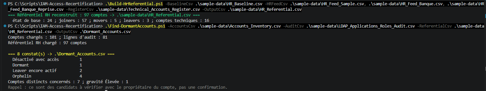
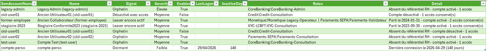
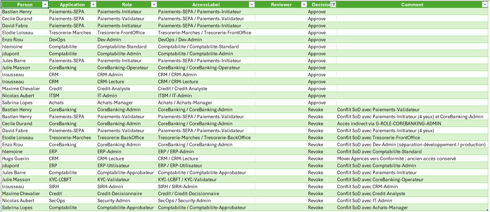
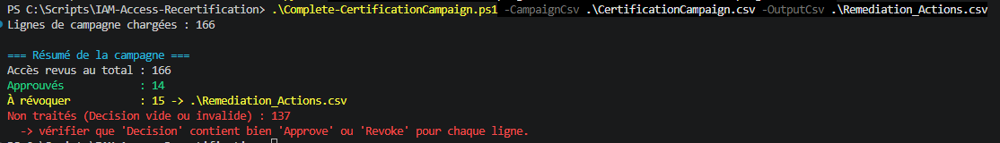

# 🔁 IAM Access Recertification


[](LICENSE)

Boîte à outils PowerShell open source de gouvernance des accès IAM, inspirée des campagnes de
recertification type SailPoint IdentityIQ. Elle **ferme la boucle** de l'audit d'accès :

1. **Détecter** les violations de séparation des tâches (SoD)
2. **Repérer** les rôles "alibi" (définis mais quasi-inutilisés)
3. **Générer** une campagne de recertification à faire revoir par les propriétaires d'accès
4. **Traiter** la campagne remplie en actions de remédiation concrètes (accès à révoquer)

Prend en entrée le CSV produit par [LDAP-App-Role-Audit](https://github.com/Anne-LaureS/LDAP-App-Role-Audit)
(ou tout export au même format Application/Role/Members). La suite logique — exécuter
réellement les révocations décidées ici (et plus largement gérer le cycle de vie des comptes,
Joiner/Mover/Leaver) — est traitée par
[IAM-JML-Lifecycle](https://github.com/Anne-LaureS/IAM-JML-Lifecycle).

Contrairement à `LDAP-App-Role-Audit`, ces scripts ne dépendent d'aucune fonctionnalité
Windows — pur traitement CSV/JSON, testable et utilisable sous Windows, Linux ou macOS avec
PowerShell 7+.

## ⚙️ Les scripts (dans l'ordre d'exécution)

| # | Script | Rôle | Sortie |
|---|---|---|---|
| 0 | [`Find-CrossAppAdminOverlap.ps1`](Find-CrossAppAdminOverlap.ps1) | *(optionnel)* Amorce des règles SoD candidates quand `sod-rules.json` n'existe pas encore | `Candidate_SoD_Rules.json`, `Candidate_SoD_Rules_Evidence.csv` |
| — | *(revue métier des candidats, puis écriture de `sod-rules.json`)* | | |
| 1 | [`Find-SoDViolations.ps1`](Find-SoDViolations.ps1) | Détecte les personnes cumulant deux accès déclarés incompatibles | `SoD_Violations.csv` |
| 2 | [`Find-AlibiRoles.ps1`](Find-AlibiRoles.ps1) | Repère les rôles vides ou quasi-vides, candidats à nettoyer | `Alibi_Roles_Candidates.csv` |
| 2a | [`Build-HrReferential.ps1`](Build-HrReferential.ps1) | *(prépare l'entrée de 2b)* Reconstruit le référentiel RH depuis des sources indépendantes de l'annuaire : état de base du personnel, flux RH rejoués, registre des comptes techniques | `HR_Referential.csv` |
| 2b | [`Find-DormantAccounts.ps1`](Find-DormantAccounts.ps1) | Détecte les comptes dormants, orphelins, leavers encore actifs et désactivés qui gardent des accès (croise inventaire des comptes, audit des rôles et référentiel RH) | `Dormant_Accounts.csv` |
| 3 | [`New-CertificationCampaign.ps1`](New-CertificationCampaign.ps1) | Génère une feuille de revue (1 ligne par personne + accès) | `CertificationCampaign_AAAA-MM-JJ.csv` |
| — | *(remplissage manuel de la colonne Decision par les reviewers)* | | |
| 4 | [`Complete-CertificationCampaign.ps1`](Complete-CertificationCampaign.ps1) | Traite la feuille remplie en liste de révocations | `Remediation_Actions.csv` |

## ▶️ Utilisation

Les commandes ci-dessous s'exécutent depuis la racine du repo et sont directement à
copier-coller.

### 0. Amorcer des règles SoD candidates (optionnel, si vous n'avez pas encore de sod-rules.json)

```powershell
.\Find-CrossAppAdminOverlap.ps1 -AuditCsv .\sample-data\LDAP_Applications_Roles_Audit.csv -PrivilegeKeyword Admin -RulesOutputJson .\Candidate_SoD_Rules.json -EvidenceOutputCsv .\Candidate_SoD_Rules_Evidence.csv
```

Repère les personnes qui cumulent un rôle contenant `-PrivilegeKeyword` (`Admin` par défaut,
insensible à la casse/accents) sur **deux applications différentes ou plus**, et génère une
règle SoD candidate par paire, avec la liste des personnes réellement concernées aujourd'hui
dans `Candidate_SoD_Rules_Evidence.csv` — pour prioriser la validation métier plutôt que de
partir d'une page blanche.

⚠️ **Portée volontairement limitée** : ce script ne détecte que les cumuls **privilège +
privilège** (ex: Admin sur l'application A et Admin sur l'application B). Un cumul asymétrique
(ex: Admin sur une application + simple accès Utilisateur sur une autre) peut tout autant être
un conflit métier réel, mais dépend du contexte fonctionnel des deux applications — un mot-clé
générique ne peut pas le déterminer sans risquer de multiplier les faux positifs (n'importe qui
ayant un accès ailleurs se ferait signaler). Ces cas-là restent à repérer manuellement en
inspectant l'audit, comme pour les 2 autres règles de l'exemple ci-dessous.

### 1. Détection des violations SoD

```powershell
.\Find-SoDViolations.ps1 -AuditCsv .\sample-data\LDAP_Applications_Roles_Audit.csv -SoDRulesJson .\sod-rules.json -OutputCsv .\SoD_Violations.csv
```

Les règles SoD sont définies dans un fichier JSON, une paire d'accès incompatibles par règle
(voir [`sod-rules.json`](sod-rules.json)) :

```json
[
  {
    "RuleName": "Nom de la règle métier",
    "Access1": "Application:Role",
    "Access2": "Application:Role"
  }
]
```

Un `Role` vide dans la clé (`"Application:"`) désigne l'accès direct à l'application elle-même
(pas via un rôle), au même format que la colonne `Role` de l'audit d'entrée.

[`sod-rules-examples.json`](sod-rules-examples.json) est un catalogue de règles SoD classiques
en entreprise (Finance, Achats, IT, RH, Sécurité, ITIL/SOX) — à adapter avec les vrais noms
d'application/rôle de votre annuaire ; ce ne sont que des exemples génériques, pas exécutables
tel quel contre `sample-data/`. Les règles réellement utilisées dans l'exemple ci-dessous
([`sod-rules.json`](sod-rules.json)) sont, elles, dérivées des cumuls constatés dans
`sample-data/`.

### 2. Détection des rôles alibi

```powershell
.\Find-AlibiRoles.ps1 -AuditCsv .\sample-data\LDAP_Applications_Roles_Audit.csv -MinMemberThreshold 1 -OutputCsv .\Alibi_Roles_Candidates.csv
```

Signale les rôles à 0 membre ("Vide") et ceux à `MinMemberThreshold` membre(s) ou moins
("Quasi-vide"). Ce sont des **candidats à vérifier manuellement** : sans données de dernière
activité (non disponibles via LDAP seul), le script ne peut pas confirmer qu'un rôle est
réellement obsolète, seulement qu'il mérite qu'on s'y penche.

### 2b. Comptes dormants, orphelins et leavers encore actifs

```powershell
.\Find-DormantAccounts.ps1 -AccountsCsv .\sample-data\Accounts_Inventory.csv -AuditCsv .\sample-data\LDAP_Applications_Roles_Audit.csv -ReferentialCsv .\sample-data\HR_Referential.csv -DormantDays 90 -OutputCsv .\Dormant_Accounts.csv
```



Trois sources croisées, toutes en CSV (aucune connexion à l'annuaire) :
- l'**inventaire des comptes** (`Get-LdapAccountInventory.ps1` de
  [LDAP-App-Role-Audit](https://github.com/Anne-LaureS/LDAP-App-Role-Audit)) : état, création,
  dernière connexion ;
- l'**audit des rôles**, pour savoir quels accès chaque compte détient encore ;
- un **référentiel RH** (`SamAccountName`, `Status` Active/Left, `Type` Employee/Admin/Service/Test/
  Builtin, `Owner`, `LeaveDate`), la source qui dit qui est censé avoir un compte. Il doit venir de
  sources **indépendantes de l'annuaire** : un référentiel tiré de l'AD lui-même ne peut pas révéler
  un orphelin. `Build-HrReferential.ps1` l'assemble (voir ci-dessous).

#### Construire le référentiel : `Build-HrReferential.ps1`

```powershell
.\Build-HrReferential.ps1 -BaselineCsv .\sample-data\HR_Baseline.csv -HRFeedCsv .\sample-data\HR_Feed_Sample.csv, .\sample-data\HR_Feed_Banque.csv, .\sample-data\HR_Feed_Banque_Reprise.csv -RegisterCsv .\sample-data\Technical_Accounts_Register.csv -OutputCsv .\sample-data\HR_Referential.csv
```

| Source | Contenu | Équivalent en entreprise |
|---|---|---|
| `HR_Baseline.csv` | état de base : personnel connu avant les flux (dont deux personnes parties, avec leur date) | SIRH, situation initiale |
| `HR_Feed_*.csv` | flux Joiner / Mover / Leaver, rejoués **dans l'ordre** ; l'identifiant est calculé comme `New-Joiner.ps1` (initiale + nom, sans accents) | export périodique du SIRH |
| `Technical_Accounts_Register.csv` | comptes admin, service, test et intégrés, avec type et propriétaire | CMDB / registre IT (pas le SIRH) |

Un compte de l'annuaire absent de ces trois sources est un orphelin. Les flux ne portent pas de date
de départ : `LeaveDate` n'est renseignée que pour l'état de base.

#### Les signaux

Résultat sur le lab, ouvert en tableau (`Dormant_Accounts.csv`) :



Quatre signaux, un par ligne de résultat (un compte peut en cumuler plusieurs) :

| Signal | Condition |
|---|---|
| **Leaver encore actif** | le référentiel dit que la personne est partie, mais le compte est activé ou garde des accès |
| **Désactivé avec accès** | compte désactivé toujours membre d'un ou plusieurs rôles |
| **Orphelin** | compte absent du référentiel RH, activé ou avec des accès |
| **Dormant** | compte activé sans connexion depuis `-DormantDays` jours (90 par défaut), ou jamais connecté depuis sa création s'il a plus de `-DormantDays` jours |

La gravité est **Élevée** si un rôle détenu contient `-PrivilegeKeyword` (`Admin` par défaut),
**Moyenne** si le compte a au moins un accès applicatif, **Faible** sinon. Les comptes intégrés
(`Type=Builtin` : Administrateur, Invité, krbtgt) sont ignorés. Sans `-ReferentialCsv`, seuls
« Désactivé avec accès » et « Dormant » sont produits.

⚠️ `lastLogonTimestamp` est répliqué avec un décalage pouvant atteindre environ 14 jours : n'utilisez
que des seuils de plusieurs dizaines de jours. Ce sont des **candidats à vérifier avec le
propriétaire du compte**, pas des confirmations.

### 3. Génération d'une campagne de recertification

```powershell
.\New-CertificationCampaign.ps1 -AuditCsv .\sample-data\LDAP_Applications_Roles_Audit.csv -OutputCsv .\CertificationCampaign.csv
```

Produit un CSV (ouvrable dans Excel/LibreOffice) avec une ligne par personne + accès, et des
colonnes vides `Reviewer`, `Decision`, `Comment` à faire remplir par le propriétaire de
l'application ou le manager concerné. `Decision` attend `Approve` ou `Revoke`.

### 4. Traitement de la campagne remplie

```powershell
.\Complete-CertificationCampaign.ps1 -CampaignCsv .\CertificationCampaign.csv -OutputCsv .\Remediation_Actions.csv
```

Lit la colonne `Decision` remplie (insensible à la casse) et produit :
- un CSV des accès à révoquer ([`Remediation_Actions.csv`](Remediation_Actions.csv) par défaut)
- un résumé en console : nombre d'accès approuvés, révoqués, et non traités (lignes où
  `Decision` est resté vide ou ne vaut ni `Approve` ni `Revoke`)

## 📊 Exemple de bout en bout

Les données d'exemple ([`sample-data/`](sample-data)) sont un audit réel du **lab Active Directory
enrichi** décrit dans [LDAP-App-Role-Audit](https://github.com/Anne-LaureS/LDAP-App-Role-Audit) et
[IAM-JML-Lifecycle](https://github.com/Anne-LaureS/IAM-JML-Lifecycle) : 20 applications, 81 lignes
d'audit, 92 personnes. L'audit a été produit avec `-ResolveNested`, qui remplace les groupes
imbriqués par les personnes qu'ils contiennent ; sans cette option, les accès obtenus via un profil
`G-ROLE-*` ne seraient pas vus. Les règles SoD sont dans [`sod-rules.json`](sod-rules.json) (12 règles :
3 du lab initial, 9 bancaires). Les anomalies attendues sont listées dans
[`Lab_ANOMALIES.md`](https://github.com/Anne-LaureS/IAM-JML-Lifecycle/blob/main/sample-data/Lab_ANOMALIES.md).

Sortie réelle obtenue en exécutant les 4 scripts à la suite :

| Étape | Sortie |
|---|---|
| [`Find-CrossAppAdminOverlap.ps1`](Find-CrossAppAdminOverlap.ps1) | [`Candidate_SoD_Rules_Evidence.csv`](Candidate_SoD_Rules_Evidence.csv) — 4 candidats parmi 23 personnes ayant un rôle Admin : `lrousseau` (CRM + SIRH), `Enzo Riou` (CoreBanking + DevOps), `Fabien Guillot` (Monetique + Risques), `Nicolas Aubert` (ITSM + SecOps). Ne détecte que les cumuls Admin + Admin : les cumuls asymétriques (Admin + accès simple) restent à écrire à la main dans `sod-rules.json` |
| [`Find-SoDViolations.ps1`](Find-SoDViolations.ps1) | [`SoD_Violations.csv`](SoD_Violations.csv) — **14 violations** pour 13 personnes, dont 11 issues des règles bancaires : Paiements initiateur + validateur (`David Fabre`, `Bastien Henry`), Crédit analyste + décisionnaire (`Maxime Chevalier`), Trésorerie front + back office (`Elodie Loiseau`), Admin Coeur bancaire + validateur Paiements (`Bastien Henry`, `Cecile Durand`), etc. `Cecile Durand` n'a cet accès Admin que **par un groupe imbriqué** : elle n'apparaît pas sans `-ResolveNested` |
| [`Find-AlibiRoles.ps1`](Find-AlibiRoles.ps1) | [`Alibi_Roles_Candidates.csv`](Alibi_Roles_Candidates.csv) — **24 candidats** : 2 rôles vides (`Credit-Legacy-Admin`, `PAM-Privileged-Test`) et 22 quasi-vides à 1 membre, essentiellement des rôles Admin tenus par un seul administrateur, à arbitrer en revue plutôt qu'à supprimer |
| [`Find-DormantAccounts.ps1`](Find-DormantAccounts.ps1) | [`Dormant_Accounts.csv`](Dormant_Accounts.csv) — **8 constats sur 7 comptes** (101 comptes examinés, référentiel RH simulé de 97 lignes) : 4 orphelins (`legacy-admin`, `old-user01`, `old-user02`, `test-user`), 2 leavers encore actifs (`former-employee`, `stagiaire-2023`), 1 compte désactivé avec accès (`old-user01`) et 1 dormant réel (un compte personnel de l'annuaire, 148 jours sans connexion). Les 3 leavers traités par JML (désactivés, sans groupe) ne ressortent pas : c'est le bon comportement |
| [`New-CertificationCampaign.ps1`](New-CertificationCampaign.ps1) | [`CertificationCampaign.csv`](CertificationCampaign.csv) — **166 lignes** à revoir (1 par personne/accès, 92 personnes). Seules les lignes liées aux violations SoD et à un mover mal traité (`Hugo Guerin`) sont décidées ici, à titre d'exemple : 29 décisions |
| [`Complete-CertificationCampaign.ps1`](Complete-CertificationCampaign.ps1) | [`Remediation_Actions.csv`](Remediation_Actions.csv) — **15 révocations** (14 approuvés, 137 non traités) |

Le **référentiel RH** ([`HR_Referential.csv`](sample-data/HR_Referential.csv), 97 comptes) est
reconstruit par `Build-HrReferential.ps1` à partir d'un état de base (24 personnes), des flux RH de
[IAM-JML-Lifecycle](https://github.com/Anne-LaureS/IAM-JML-Lifecycle) (57 arrivées, 3 départs) et d'un
registre de 16 comptes techniques. **La source RH reste simulée pour le lab** : dans une organisation
réelle, elle vient du SIRH et de la CMDB. L'inventaire publié,
[`Accounts_Inventory.csv`](sample-data/Accounts_Inventory.csv), est une copie de l'export réel où
l'identifiant d'un compte personnel a été remplacé par un pseudonyme.

⚠️ Sur ce lab, **une seule** détection repose sur une vraie date de connexion : les comptes ont été
créés récemment et la plupart ne se sont jamais connectés, donc aucune ancienneté réelle n'est
disponible. Les comptes dormants « planifiés » (`old-user01`, `legacy-admin`...) sont trouvés par leur
absence du référentiel RH ou par leur départ, pas par leur ancienneté (un attribut Active Directory
comme `lastLogonTimestamp` n'est pas modifiable). Le seuil `-DormantDays` fonctionne mais n'est
démontré que sur ce compte.

Sur le **lab initial** (8 applications, 21 utilisateurs), la même chaîne avait donné 3 violations
SoD, 12 candidats rôles alibi, une campagne de 32 lignes et 3 révocations.

La campagne se remplit à la main dans Excel/LibreOffice (colonne `Decision`) avant l'étape 4. Ci-dessous, la campagne du lab enrichi filtrée sur les lignes décidées (14 `Approve`, 15 `Revoke`) :



Puis le traitement de la campagne par `Complete-CertificationCampaign.ps1` : 166 accès revus, 14 approuvés, 15 à révoquer, 137 non traités (lignes sans décision) :



## 🔐 Sécurité & précautions

- Ces scripts ne se connectent à aucun annuaire — ils ne consomment que des CSV/JSON déjà
  exportés. Aucune donnée d'authentification en jeu ici (voir
  [LDAP-App-Role-Audit](https://github.com/Anne-LaureS/LDAP-App-Role-Audit) pour la partie
  connexion LDAP).
- Le champ `Decision` est comparé en minuscules et sans espaces superflus (`.Trim().ToLower()`)
  pour tolérer les variations de saisie manuelle (`Revoke`, `REVOKE`, `revoke `) sans faux
  négatif silencieux.
- `Find-SoDViolations.ps1` et `New-CertificationCampaign.ps1` ne sautent que les lignes sans
  aucun membre (`Members` vide) — un `Role` vide reste un accès légitime (accès direct à
  l'application) à traiter, pas une ligne à ignorer.
- Les révocations produites par `Complete-CertificationCampaign.ps1` sont une **liste
  d'actions à exécuter manuellement** (ou via votre outil de provisioning existant — voir
  [IAM-JML-Lifecycle](https://github.com/Anne-LaureS/IAM-JML-Lifecycle), qui peut exécuter ces
  révocations sur Active Directory) — ce script ne modifie aucun annuaire lui-même.
- **Fichiers `.ps1` et `.json` avec BOM UTF-8** : Windows PowerShell 5.1 lit mal les accents
  sans ce marqueur en tête de fichier (texte corrompu, voire erreur de syntaxe). Si vous
  éditez ces fichiers ou en ajoutez de nouveaux (ex: vos propres règles SoD), sauvegardez-les
  en UTF-8 avec BOM (`utf-8-sig`), pas en UTF-8 simple.

---

## 📜 Licence

Publié sous licence [MIT](LICENSE) © 2026 Anne-LaureS : réutilisation libre, à condition de conserver la
mention de copyright. Fourni « tel quel », sans garantie.
