# 🧪 midPoint Lab : gouvernance des identités sur une plateforme IGA


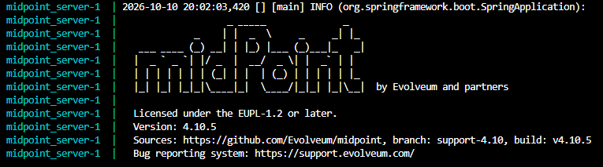

Ce laboratoire rejoue sur une plateforme **IGA** (*Identity Governance and Administration*,
[Evolveum midPoint](https://evolveum.com/midpoint/)) le cycle de vie et la recertification des accès
que les scripts PowerShell de ce dépôt traitent à la main. L'objectif est de comparer les deux
approches sur l'automatisation, la gouvernance, la traçabilité et la remédiation.

Tout est local, reproductible en une commande, et alimenté par des données **fictives**.

## Résultats

| # | Exercice | Résultat observé |
|---|---|---|
| 1 | Import des identités depuis un CSV RH | 12 utilisateurs créés, chacun rattaché à son compte source |
| 2 | Corrélation sur le matricule | un compte dissocié est retrouvé automatiquement, sans doublon |
| 3 | Modèle de rôles | 2 rôles métier, 6 affectations |
| 4 | Campagne de certification | 7 éléments relus, 1 révocation appliquée à la clôture |
| 5 | Départ (Leaver) | l'état « inactif » de la source RH désactive l'utilisateur, sans le supprimer |

## Architecture

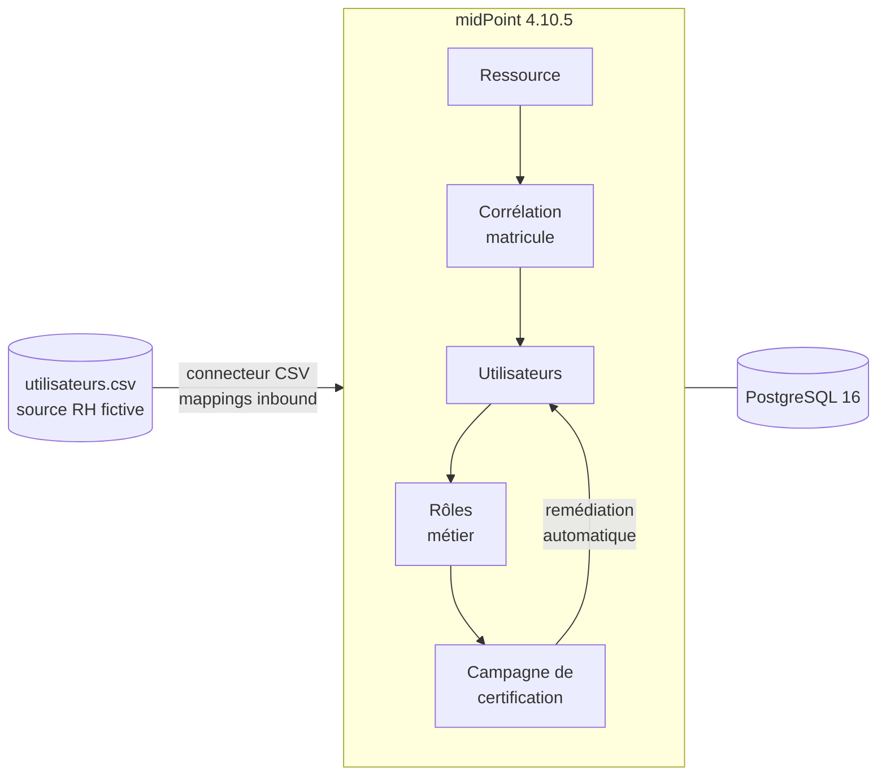

## Démarrage

**Prérequis** : Docker Desktop démarré, environ 4 Go de mémoire libres, 300 Mo à télécharger au
premier lancement.

```bash
cd midpoint-lab
cp .env.example .env      # remplacer DB_PASSWORD par un mot de passe long et aléatoire
docker compose up -d
docker compose logs -f midpoint_server    # attendre le message de démarrage, puis Ctrl+C
```

Interface : <http://localhost:8080/midpoint> (liée à `127.0.0.1`, non exposée).

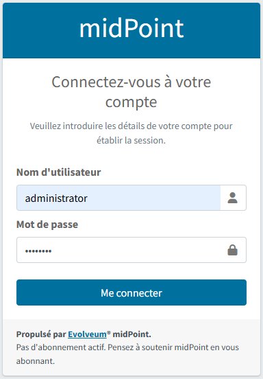

Le compte est `administrator`. midPoint n'a plus de mot de passe par défaut depuis la 4.8.1 : il en
génère un au premier démarrage, lisible dans ses journaux.

```bash
docker compose logs midpoint_server 2>&1 | grep "Administrator initial password"
```

## Jeu de données

`data/utilisateurs.csv` contient 12 personnes fictives (domaine `example.test`), construites avec des
cas que l'on rencontre dans des données RH réelles :

| Cas | Ce qu'il permet de tester |
|---|---|
| E1001 et E1012 partagent la même adresse e-mail | le choix de l'identifiant de corrélation |
| E1010 est `inactif`, avec une date de sortie | le traitement d'un départ |
| une hiérarchie `manager` | la désignation d'un relecteur |
| 4 départements | la construction d'un modèle de rôles |

## Les exercices

Chaque exercice est détaillé ci-dessous, avec ses captures.

<details>
<summary><b>1. Import des identités</b> : ressource CSV, mappings, synchronisation</summary>

1. Ressource « Source CSV RH » créée à partir de zéro, connecteur CSV, état *Actif (production)*.
   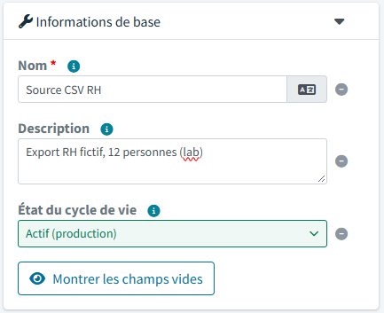
2. Connecteur : fichier `/opt/midpoint/var/import/utilisateurs.csv`, séparateur `,`, attribut unique
   `matricule`, attribut de nom `login` (réglages retrouvés par la découverte automatique).
3. Type d'objet « Compte personne CSV » : sorte *Compte*, par défaut, créant un *Utilisateur*.
   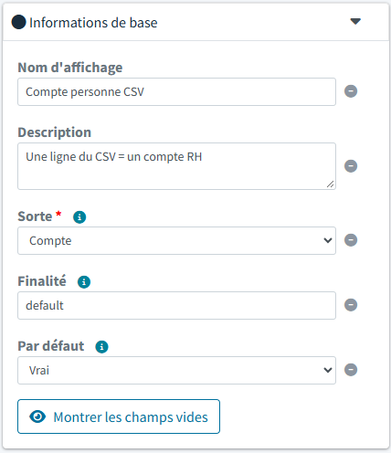
4. Six mappings *inbound*, du CSV vers l'utilisateur :
   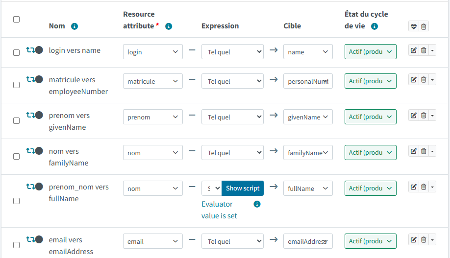
5. Trois réactions de synchronisation : *non apparié* crée l'utilisateur, *non lié* lie, *lié*
   synchronise.
   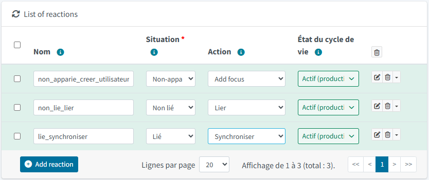
6. Import depuis l'onglet *Comptes* : 12 utilisateurs, plus `administrator`.
   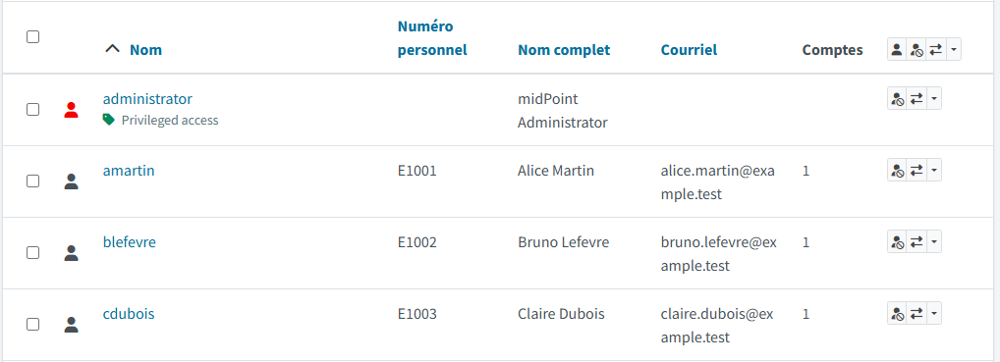

Le nom complet est calculé par un script Groovy (`prenom` est une source déclarée, `input` est
l'attribut principal `nom`) :

```groovy
basic.stringify(prenom) + ' ' + basic.stringify(input)
```

</details>

<details>
<summary><b>2. Corrélation</b> : retrouver la bonne identité à partir du matricule</summary>

1. Règle de corrélation sur le type d'objet : poids 1, palier 1, activée.
   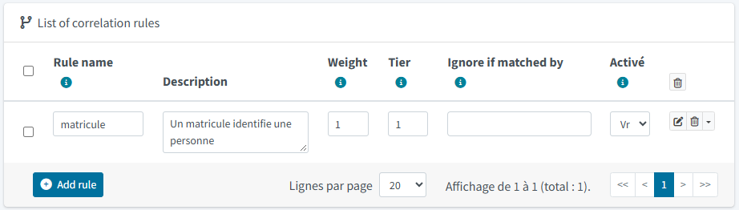
2. Élément comparé : `personalNumber`, méthode *Exact match*.
   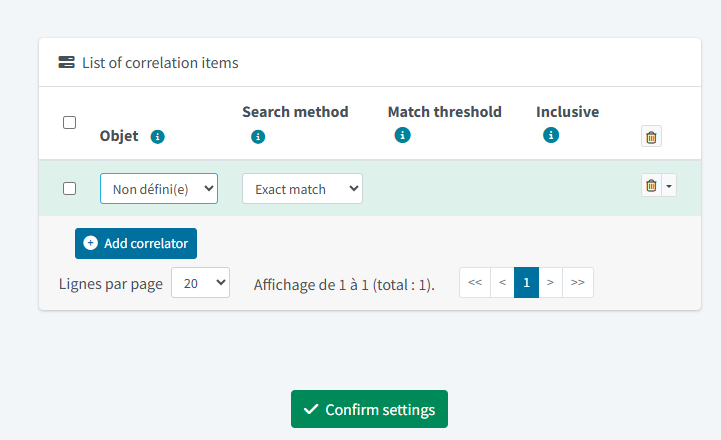
3. Pour provoquer un cas à corréler, le compte d'`amartin` est dissocié (et non supprimé) depuis
   l'onglet *Projections*.
   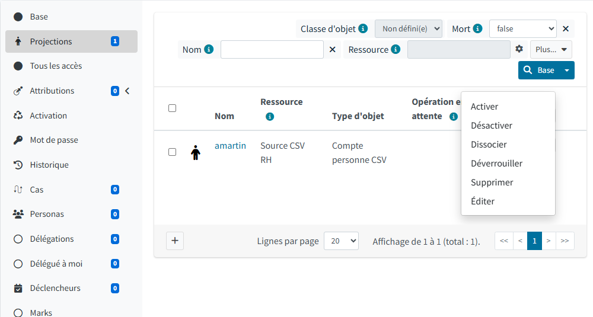
   Le compte reste sur la ressource, orphelin :
   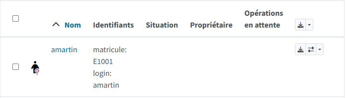
4. Réimport de ce seul compte : il est de nouveau `LINKED` à `amartin`, il y a toujours 13
   utilisateurs et aucun doublon.
   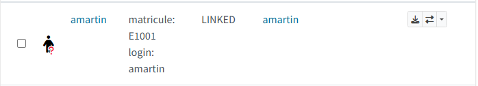

</details>

<details>
<summary><b>3. Rôles</b> : deux rôles métier et six affectations</summary>

Deux rôles de type *Rôle métier*, sans droit technique derrière (un rôle qui créerait un compte sur
la ressource CSV écrirait dans le fichier source) :

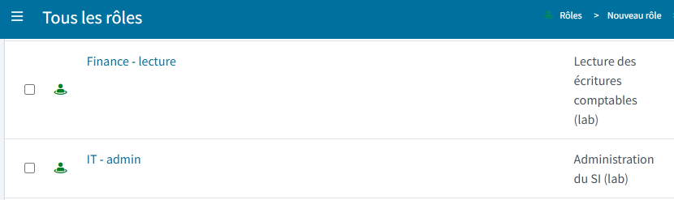

| Rôle | Utilisateurs |
|---|---|
| `Finance - lecture` | amartin, blefevre, cdubois |
| `IT - admin` | fsimon, gmichel, jfournier |

`kgirard` (Finance) n'a volontairement aucun rôle, et `jfournier`, inactif, garde `IT - admin` : deux
cas destinés à ressortir à la certification.

</details>

<details>
<summary><b>4. Campagne de certification</b> : relecture, décision, remédiation</summary>

1. Définition de campagne : utilisateurs, attributions de type rôle uniquement, éléments inactifs
   inclus.
   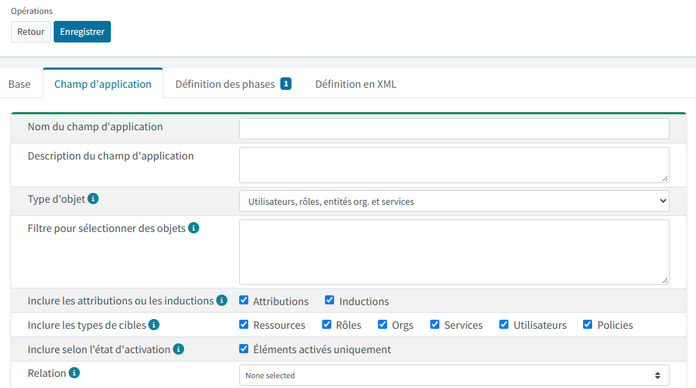
2. Une étape de 7 jours (`P7D`), relecteur `administrator`, remédiation automatisée.
   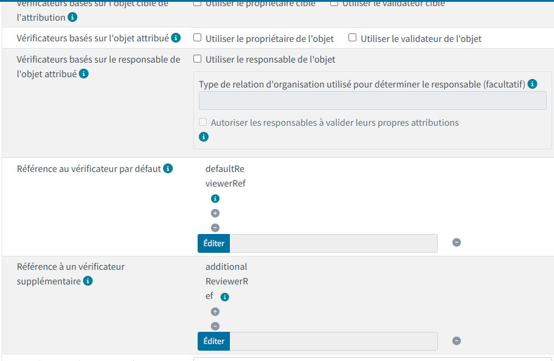
3. La campagne remonte 7 éléments : les 6 affectations ci-dessus et `Superuser`, que midPoint donne à
   son propre administrateur.
   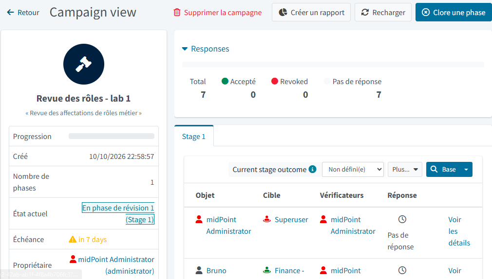
4. Décisions : 6 acceptées (dont `Superuser`), 1 révoquée : `IT - admin` pour `jfournier`.
   
5. Clôture de la phase puis de la campagne : la révocation est appliquée.
   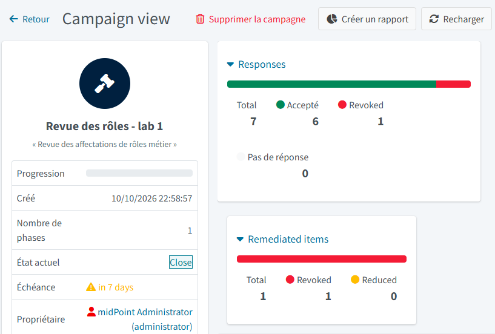

Tant que la campagne n'est pas close, l'affectation révoquée existe encore : une décision n'est pas
une remédiation.

</details>

<details>
<summary><b>5. Départ (Leaver)</b> : l'état de la source RH pilote l'activation</summary>

La colonne `statut` n'était pas mappée : `jfournier` (inactif dans le CSV) restait actif dans
midPoint. Un mapping *inbound* vers `activation/administrativeStatus` règle cela :

```groovy
input == 'inactif' ? 'disabled' : 'enabled'
```


Après réimport, `jfournier` est désactivé :
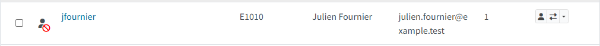

Pour simuler un vrai départ, `kgirard` passe à `inactif` dans le CSV puis le compte est réimporté :


Aucune suppression : les fiches et les comptes restent consultables.

État final après restauration du CSV d'origine :

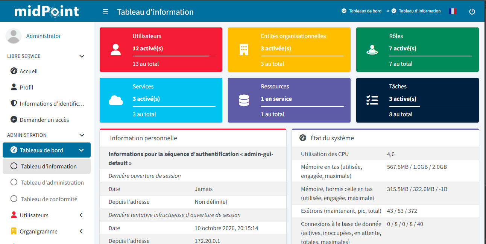

</details>

## Comparaison avec les scripts PowerShell du dépôt

| Aspect | Scripts du dépôt | midPoint |
|---|---|---|
| Création et rattachement des comptes | via CSV et scripts | séparation identité / compte, liens gérés par le produit |
| Recherche de la bonne personne | à écrire dans le script | règle de corrélation déclarative |
| Revue des accès | feuille CSV remplie à la main | campagne avec relecteur, décisions horodatées |
| Application des révocations | liste d'actions (`Remediation_Actions.csv`) à exécuter ailleurs | remédiation appliquée à la clôture de la campagne |
| Traçabilité | fichiers produits par les scripts | journal d'audit de chaque opération |

## Points d'attention

- **`employeeNumber` est déprécié depuis la 4.8** : la cible du matricule est `personalNumber`.
- **`Superuser` entre dans le périmètre** d'une campagne sur « tous les utilisateurs » : le révoquer
  coupe l'accès à la console.
- **Dissocier n'est pas supprimer** : *Supprimer* un compte efface aussi la ligne dans une source
  CSV accessible en écriture.

## Limites

- Échelle réduite : 12 personnes, une seule source CSV, un seul relecteur.
- Les rôles ne portent pas de droits techniques réels.
- L'affectation automatique par département n'est pas faite : les rôles sont affectés à la main.
- La corrélation sur l'e-mail (cas E1001 / E1012) n'a pas été testée.

## Suite prévue

- Connecteur **AD/LDAP** vers un annuaire de test.
- **SSO OIDC** de la console midPoint avec un tenant Okta.
- Connecteur **Okta** communautaire (`net.tirasa.connid.bundles.okta`), dont la compatibilité avec la
  4.10 reste à vérifier.

## Arrêt et nettoyage

```bash
docker compose down        # arrête, conserve les données
docker compose down -v     # arrête et supprime la base et la configuration
```

## Origine et licences

Le `docker-compose.yml` est dérivé de [Evolveum/midpoint-docker](https://github.com/Evolveum/midpoint-docker)
(Apache-2.0). midPoint est publié par Evolveum sous EUPL-1.2 ou ultérieure. Le contenu de ce dossier
suit la licence MIT du dépôt.
