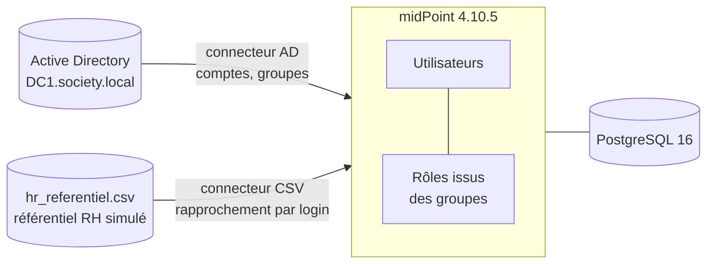
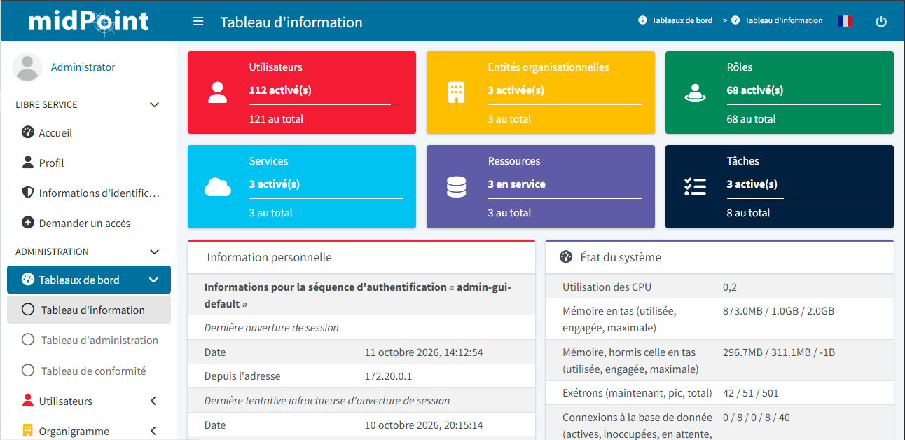

# 🧪 midPoint Lab : gouvernance des identités sur une plateforme IGA


Ce laboratoire rejoue sur une plateforme **IGA** (*Identity Governance and Administration*,
[Evolveum midPoint](https://evolveum.com/midpoint/)) le cycle de vie et la recertification des accès
que les scripts PowerShell de ce dépôt traitent à la main. L'objectif est de **comparer les deux
approches** : ce que chacune détecte, comment elle trace et comment elle remédie, sur un annuaire et des
règles identiques.

midPoint se lance en une commande, avec des données **fictives**. La comparaison suppose un annuaire
Active Directory de test, qui n'est pas fourni.

## 📊 Résultat : scripts PowerShell contre midPoint

Les mêmes contrôles, sur le même annuaire de test : 102 comptes dans l'inventaire des scripts, 108 lus
par midPoint (6 comptes machine en plus), 61 groupes d'application.

Un accès est **direct** quand la personne est membre du groupe de l'application, **indirect** quand elle
est membre d'un autre groupe lui-même inclus dans celui de l'application (groupes imbriqués). Les scripts
ont été lancés deux fois : en suivant les accès indirects (option `-ResolveNested`), et sans, ce qui les
place sur le même périmètre que midPoint.

| Contrôle | Scripts PowerShell, accès directs et indirects | Scripts PowerShell, accès directs seulement | midPoint (accès directs) |
|---|---|---|---|
| Comptes et états | référence | référence | identique sur les 102 comptes communs |
| Comptes orphelins         | 6                          | 6                  | ✅ 6                                    |
| Leavers encore actifs     | 2                          | 2                  | ✅ 2                                    |
| Désactivé avec accès   | 1                          | 1                  | ✅ 1                                    |
| Appartenances aux groupes | 166                        | 158                | ✅ 158 (les mêmes)                     |
| Violations SoD            | 14                         | 13                 | ✅ 13                                   |
| Rôles vides | 2 | 2 | ⚠️ 7 : les mêmes 2, plus 5 rôles dont le seul membre est un groupe imbriqué |
| Comptes dormants          | 1                          | 1                  | ❓ donnée trop pauvre                  |

**À périmètre égal (accès directs), midPoint égale les scripts** sur les orphelins, les leavers, les comptes désactivés,
les appartenances et la SoD. Deux écarts subsistent, expliqués :

- **Groupes imbriqués** : midPoint ne les suit pas tant que la hiérarchie n'est pas modélisée (8
  appartenances et 1 violation SoD de moins que les scripts qui suivent les accès indirects).
- **Rôles vides** : un rôle dont le seul membre est un groupe imbriqué (`G-ROLE-…`) est vide pour
  midPoint, qui ne compte que des utilisateurs, mais pas pour le script, qui compte le groupe comme
  membre. Les 5 rôles en plus sont dans ce cas : `Achats-Admin`, `Credit-Admin`, `KYC-Admin`,
  `Paiements-Admin` et `Tresorerie-Admin`.

**Conclusion.** Les deux approches couvrent les mêmes besoins : détecter, tracer, remédier. Elles
diffèrent par la méthode.

| Besoin | Scripts PowerShell | midPoint |
|---|---|---|
| Détection | un script par contrôle, à la demande | requêtes sur des données synchronisées |
| Traçabilité | fichiers CSV produits à chaque exécution | journal d'audit de chaque opération |
| Remédiation | liste de révocations à exécuter (`Remediation_Actions.csv`) | révocation appliquée à la clôture |
| Adaptation | modification du code | interface, puis XML à la main |

Sur la détection, à périmètre égal, les résultats sont les mêmes, et les scripts font mieux tant que la
hiérarchie des groupes n'est pas modélisée dans midPoint. Les lignes traçabilité et remédiation ont été
constatées lors de la prise en main (campagne de certification, révocation appliquée, journal d'audit).

Le détail des mesures est dans [docs/active-directory.md](docs/active-directory.md).

Avant cette comparaison, une prise en main de midPoint a été faite sur un CSV fictif (import, corrélation,
rôles, campagne de certification, départ) : [docs/exercices.md](docs/exercices.md).

## 🏗️ Architecture



## 🚀 Démarrage

**Prérequis** : Docker Desktop démarré, environ 4 Go de mémoire libres, 300 Mo à télécharger au
premier lancement.

```bash
cd midpoint-lab
./lab.sh up        # crée .env avec un mot de passe aléatoire, puis démarre
docker compose logs -f midpoint_server    # attendre le message de démarrage, puis Ctrl+C
```

Interface : [http://localhost:8888/midpoint](http://localhost:8888/midpoint) (liée à `127.0.0.1`, non exposée).

> Le port est **8888** : sous Windows, 8080 est souvent réservé par le système. Pour en changer,
> définir `MP_PORT` dans `.env` puis `./lab.sh stop && ./lab.sh up`.


Le compte est `administrator`. midPoint n'a plus de mot de passe par défaut depuis la 4.8.1 : il en
génère un au premier démarrage, lisible dans ses journaux.

```bash
docker compose logs midpoint_server 2>&1 | grep "Administrator initial password"
```

## 🚧 Limites

- Les **groupes imbriqués** ne sont pas modélisés : les appartenances indirectes sont invisibles, ce
  qui explique à lui seul les écarts sur les appartenances, la SoD et les rôles vides.
- Le **rapprochement par login** est fragile (un compte renommé n'est pas retrouvé) : un identifiant
  stable serait nécessaire.
- Les contrôles de la comparaison sont des **requêtes** sur la base de midPoint, pas des rapports natifs.
- Les comptes dormants ne peuvent pas être évalués : l'annuaire de test n'a que 4 dates de connexion.

## 🧹 Arrêt et nettoyage

```bash
./lab.sh stop      # arrête, conserve les données
./lab.sh clean     # remise à zéro complète : conteneurs, réseau, volumes ET .env
./lab.sh status    # conteneurs, volumes, présence du .env
```

`clean` demande une confirmation et vérifie qu'il ne reste aucun volume. Il supprime aussi le
`.env` : le mot de passe de la base est lié au volume, les deux partent donc ensemble. Le script
`up` refuse de démarrer si un `.env` manque alors que des volumes existent, ce qui évite le
désaccord entre mot de passe et base.

## 📸 État final

121 utilisateurs (112 actifs), 68 rôles dont 61 issus des groupes, 3 ressources.



## 📚 Origine et licences

Le `docker-compose.yml` est dérivé de [Evolveum/midpoint-docker](https://github.com/Evolveum/midpoint-docker)
(Apache-2.0). midPoint est publié par Evolveum sous EUPL-1.2 ou ultérieure. Le contenu de ce dossier
suit la licence MIT du dépôt.
