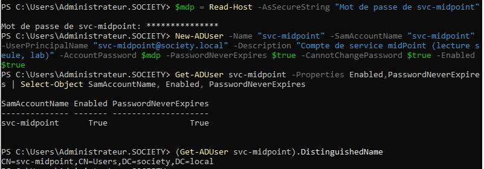
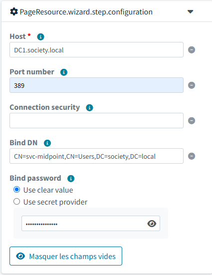
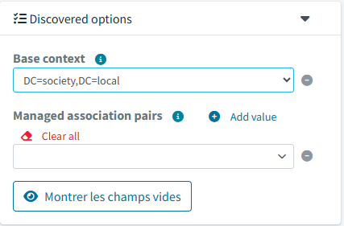
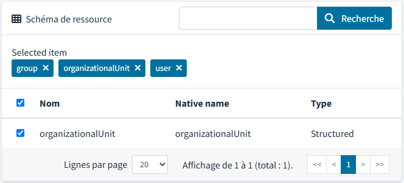
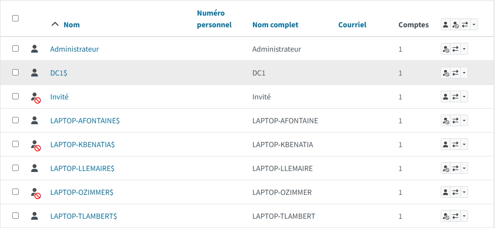
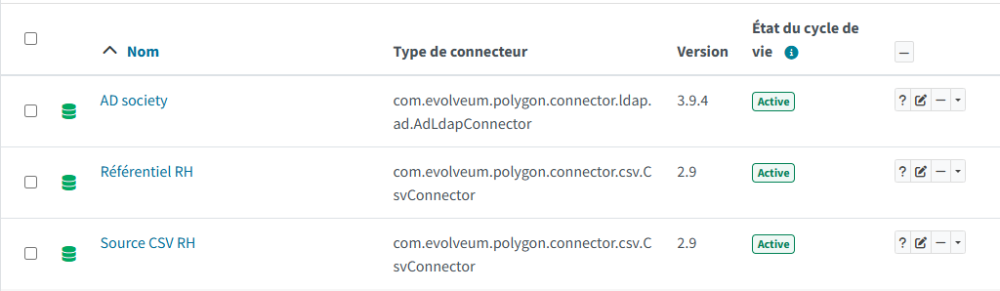
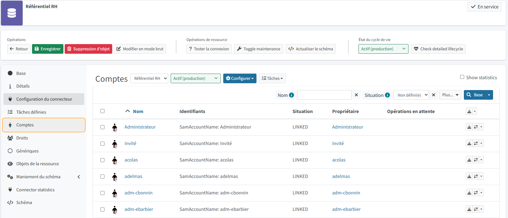
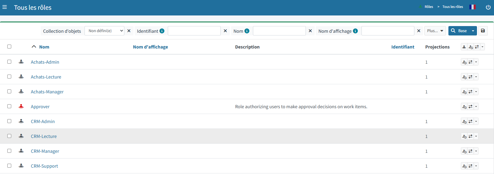
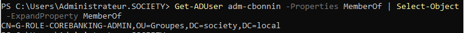

[← Retour au README](../README.md)

# 🔌 Connexion à Active Directory

Cette partie branche midPoint sur un contrôleur de domaine de test (`DC1.society.local`, Windows
Server 2022), le même que celui des autres dépôts de ce compte.

**Joignabilité.** Avant toute configuration, les ports 389 (LDAP) et 636 (LDAPS) du contrôleur ont
été testés depuis Windows, depuis WSL et **depuis le conteneur midPoint** : ouverts dans les trois
cas, et le nom `DC1.society.local` est résolu depuis le conteneur.

**Compte de service dédié.** Plutôt que de réutiliser un compte administrateur, un compte
`svc-midpoint` est créé : membre de « Utilisateurs du domaine » seulement, ce qui suffit à *lire*
l'annuaire. Le mot de passe est saisi dans la console (jamais dans une commande ni dans le dépôt).

```powershell
$mdp = Read-Host -AsSecureString "Mot de passe de svc-midpoint"
New-ADUser -Name "svc-midpoint" -SamAccountName "svc-midpoint" -UserPrincipalName "svc-midpoint@society.local" -Description "Compte de service midPoint (lecture seule, lab)" -AccountPassword $mdp -PasswordNeverExpires $true -CannotChangePassword $true -Enabled $true
```

Le nom distinctif du compte, tel que le renvoie l'annuaire, est celui qu'attend le connecteur :

```powershell
(Get-ADUser svc-midpoint).DistinguishedName
# CN=svc-midpoint,CN=Users,DC=society,DC=local
```



| Choix | Raison |
|---|---|
| aucun groupe d'administration | la lecture de l'annuaire suffit pour importer et pour détecter les comptes dormants |
| mot de passe sans expiration | un compte de service qui expire interrompt la synchronisation sans prévenir |
| ne peut pas changer son mot de passe | évite une modification accidentelle |

**Ressource dans midPoint.** Création « à partir de zéro » avec le connecteur Active Directory (`AdLdapConnector`), état *Actif (production)*. Elle coexiste avec la ressource CSV :




Après la connexion, midPoint découvre les contextes de l'annuaire et propose le contexte de base :



**Classes d'objets.** Le schéma de l'annuaire en expose 269 ; seules trois sont retenues :
`user`, `group` et `organizationalUnit`.



**Type d'objet.** Un seul type, « Comptes AD » : sorte *Compte*, classe `user`, créant un *Utilisateur*,
sans contexte de base, donc sur tout le domaine. Un premier essai limitait le type à
`OU=Utilisateurs` ; le périmètre a été élargi pour que midPoint voie les mêmes comptes que
l'inventaire des scripts.

**Mappings et synchronisation.** Le type porte cinq mappings *inbound* et les trois réactions de
synchronisation du lab CSV (*non apparié* crée l'utilisateur, *non lié* lie, *lié* synchronise). Ils sont
posés dans la définition XML de la ressource :

| Attribut AD | Champ midPoint |
|---|---|
| `sAMAccountName` | `name` |
| `givenName` | `givenName` |
| `sn` | `familyName` |
| `cn` | `fullName` |
| `mail` | `emailAddress` |

**Import.** Le premier import d'un seul compte (`Bind Test`) a validé la chaîne connexion, mappings et
synchronisation :


L'import porte ensuite sur tout le domaine (unités `Utilisateurs`, `Admins`, `Leavers` et conteneur
`Users`) :

| Après l'import complet | Valeur |
|---|---|
| Utilisateurs midPoint | 121 (12 du CSV, 108 de l'AD, `administrator`) |
| Comptes AD rattachés (`LINKED`) | 108 |
| dont comptes machine (`$`) | 6 |
| Utilisateurs désactivés | 9 |



**Les comptes machine sont dans le périmètre.** Dans Active Directory, la classe `user` inclut aussi les
objets ordinateur (`DC1$`, `LAPTOP-…$`). midPoint les importe donc comme des utilisateurs. C'est
utile pour voir un poste encore actif alors que son propriétaire est désactivé, mais cela donne 108
comptes là où l'inventaire des scripts en compte 102 : toute comparaison doit se faire sur le même
périmètre.

**État d'activation.** Le connecteur traduit l'indicateur `userAccountControl` en état d'activation ;
un mapping *inbound* (`activation/administrativeStatus`, tel quel) le reporte sur l'utilisateur.

## 🔎 Comparaison avec les scripts PowerShell : les comptes à risque

Le script `Find-DormantAccounts.ps1` a été relancé sur l'annuaire du jour (inventaire de 102 comptes,
audit des rôles de 20 applications, référentiel RH simulé de 97 lignes) : **10 constats sur 8 comptes**.

**Première mesure : midPoint seul.** Avec l'AD comme unique source, midPoint retrouve les 8 comptes dans
le même état, mais ne reproduit aucun signal : il ne connaît ni le référentiel RH, ni les groupes, ni
la dernière connexion.

**Seconde mesure : le référentiel RH comme deuxième source.** Le fichier est ajouté comme ressource CSV
(`Référentiel RH`) et ses comptes sont rattachés aux utilisateurs de l'AD par `SamAccountName`.





| Signal du script | Constats | Retrouvés avec midPoint + RH |
|---|---|---|
| Orphelin (compte absent du RH) | 6 | **6 sur 6** : les mêmes comptes, vus comme des utilisateurs sans compte RH |
| Leaver encore actif | 2 | **2 sur 2** : RH `Left` et utilisateur encore actif |
| Désactivé avec accès | 1 | non : les groupes d'accès ne sont pas lus |
| Dormant | 1 | non : la dernière connexion n'est pas lue |

Deux précisions sur la méthode et ses limites :

- Ces résultats sont obtenus **par requête sur la base de midPoint**, pas par un rapport natif : midPoint
  détient les faits (un utilisateur a ou non un compte RH, son état d'activation), la règle de
  détection est écrite à côté.
- Le rapprochement par nom échoue pour **un compte renommé** : il figure sous son ancien nom dans le RH
  et sous le nouveau dans l'AD, donc il apparaît à la fois comme orphelin et comme compte RH sans
  équivalent. Un vrai IGA rapproche sur un identifiant stable (matricule), pas sur le login.

Le compte de service créé pour ce lab (`svc-midpoint`) ressort aussi comme orphelin : un compte
technique non déclaré, ce qu'un inventaire rigoureux doit faire remonter.

**Dernière connexion.** Le connecteur expose l'attribut `lastLogon` (entier long au format horodatage
Windows), mais l'annuaire de test n'en renseigne que 4 sur 102 comptes, dont un seul assez ancien pour
être dormant. L'attribut n'apparaît pas dans la fiche d'un compte de l'interface et n'a pas été
exploité : avec une seule donnée, la détection n'apporterait aucune comparaison utile.

**Groupes d'accès.** Les groupes de `OU=Applications` sont importés comme rôles (61 rôles, correspondant
aux 61 rôles de l'audit PowerShell), puis chaque appartenance `memberOf` d'un compte devient une
attribution du rôle du même nom :



| Appartenances (compte, rôle) | Valeur |
|---|---|
| Selon l'audit PowerShell (avec résolution des groupes imbriqués) | 166 |
| Retrouvées dans midPoint | **158** |
| Présentes dans midPoint mais pas dans l'audit | 0 |
| Manquantes | 8 |

Les 8 manquantes sont des appartenances **indirectes** : le compte est membre d'un groupe de rôle
(`G-ROLE-…`, dans `OU=Groupes`) qui est lui-même imbriqué dans le groupe de l'application.



L'attribut `memberOf` ne renvoie que les appartenances directes : midPoint voit donc le groupe
`G-ROLE-…`, qui n'est pas un rôle importé. Les scripts PowerShell, lancés avec `-ResolveNested`,
suivent l'imbrication, ce que midPoint ne fait pas tant que ces groupes ne sont pas configurés comme
rôles reliés entre eux, ce qui n'a pas été fait ici.

**Désactivé avec accès.** Un utilisateur désactivé qui garde au moins une attribution de rôle : midPoint
en trouve **1**, le même compte que le script (1 sur 1).

**Rôles alibi : les rôles sans membre.** Un rôle « alibi » est défini mais quasi-inutilisé. Seul le cas
extrême a été mesuré : un rôle importé d'un groupe sans aucune attribution.

| | Rôles sans membre |
|---|---|
| Audit PowerShell (avec résolution des groupes imbriqués) | 2 |
| midPoint (appartenances directes) | 7 |

Les 5 rôles en plus (`Achats-Admin`, `Credit-Admin`, `KYC-Admin`, `Paiements-Admin`,
`Tresorerie-Admin`) sont des **faux positifs** : leur seul membre est indirect, par un groupe `G-ROLE-…`
imbriqué. midPoint les voit vides parce que la hiérarchie n'est pas modélisée : sans elle, ce contrôle
produit des faux positifs.

**Séparation des tâches (SoD).** Les 12 règles de `sod-rules.json` (deux accès incompatibles par règle)
ont été rejouées sur les attributions de midPoint, en cherchant les utilisateurs qui détiennent les deux
rôles d'une règle :

| | Violations |
|---|---|
| Script `Find-SoDViolations.ps1` (avec résolution des groupes imbriqués) | 14 |
| midPoint (attributions directes) | 13 |
| Communes | 13 |
| Présentes seulement dans midPoint | 0 |

La violation manquante porte sur la règle « Admin cœur bancaire + Validateur paiements » : l'accès
administrateur y est indirect, par un groupe `G-ROLE-…` imbriqué, donc invisible tant que la hiérarchie
n'est pas modélisée.

Précision de méthode : ces résultats viennent d'une **requête** sur les attributions, pas d'un rapport
natif de midPoint.

## ⚖️ Comparaison à périmètre égal

Les scripts `Get-LdapAppRoleAudit.ps1` et `Find-SoDViolations.ps1` ont été relancés **sans**
`-ResolveNested`, pour ne voir que les appartenances directes, comme midPoint :

| | Scripts (directes) | midPoint | Écart |
|---|---|---|---|
| Appartenances (compte, rôle) | 158 | 158 | aucun, les mêmes couples |
| Violations SoD | 13 | 13 | aucun |
| Signaux « orphelin », « leaver », « désactivé avec accès » | 6, 2, 1 | 6, 2, 1 | aucun |
| Rôles alibi (sans membre) | 2 | 7 | définition différente |

Pour les rôles vides, l'audit compte comme membre un groupe imbriqué (par exemple `G-ROLE-…` dans
`CoreBanking-Admin`), même sans résolution : le rôle n'est donc pas vide pour le script. midPoint, qui ne
compte que des utilisateurs, voit ces rôles vides.
